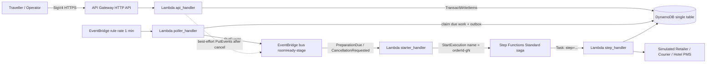

# ROOMREADY

**CDS538 Cloud Computing - Group 1 course demo.**
Travellers create a profile (sizes, allergy flags, preferred brands) and an order (flight, hotel,
room reservation reference, check-in time with an explicit UTC offset). About **T-24h before
check-in** the system prepares personalised room supplies:

1. reserve supplies at a retailer (this also creates a payment **authorization**),
2. book a courier delivery,
3. arrange room setup via the hotel PMS,
4. mark the order **READY**.

Cancellation safely undoes **only the effects that actually happened**, in reverse order (Saga
compensation). **All providers are simulated - no real payments, bookings or hotel systems.**

## Team

| Role | Members |
|---|---|
| Architecture & Design (joint) | Tianyi Zhang, Haifeng Wang |
| Implementation & Deployment | Haolun Liu, Shuxun Tang |
| Evaluation | Jiajin Hu |
| Requirements | Kang Shen |

## Runtime baseline: exactly five AWS services

| Service | Use |
|---|---|
| API Gateway (HTTP API) | Public API, `AWS_IAM` route authorization, Lambda proxy (payload v2) |
| EventBridge | 1-minute schedule rule -> poller; custom bus + rule routing `PreparationDue` / `CancellationRequested` -> starter |
| Step Functions (Standard) | Forward saga and compensation (`infra/statemachine.asl.json`) |
| Lambda | `api_handler`, `poller_handler`, `starter_handler`, `step_handler` (Python 3.12) |
| DynamoDB | One on-demand table (`PK`/`SK`) + sparse GSI `GSI1` for due work and the outbox |

Target environment: AWS Academy Learner Lab, `us-east-1`, existing **LabRole** only (no IAM roles
or policies are created), ~$50 budget, no EC2/containers. CloudFormation is deployment tooling, not
runtime.

**Excluded from the runtime on purpose** (the proposal mentioned them): CloudWatch dashboards and
alarms, X-Ray, SAM, SSM Parameter Store, SQS, SNS and S3 runtime resources. Reasons: Learner Lab
budget and LabRole restrictions, a smaller surface to verify, and the fact that every required
guarantee (idempotency, fencing, outbox, compensation) can be built from the five services above.
Lambda may write its default logs if the lab allows it, but nothing depends on them - the
business audit trail lives in DynamoDB. See [docs/DESIGN_NOTES.md](docs/DESIGN_NOTES.md).

## Architecture



The **same Python code** runs locally: `roomready.local_orchestrator` executes the very same ASL
file in-process and dispatches each Task to the same `saga.dispatch()` that the Lambda step handler
calls; a local event router and starter mimic EventBridge and `StartExecution` (including
deterministic execution names).

### Order state diagram

```mermaid
stateDiagram-v2
  [*] --> ACCEPTED: POST /orders (durable acceptance)
  ACCEPTED --> CANCELLED: cancel before claim (no provider calls)
  ACCEPTED --> PREPARING: scheduler claim at dueAt (generation + 1)
  PREPARING --> READY: all steps confirmed and no cancel requested
  PREPARING --> COMPENSATING: step failed or cancel observed
  READY --> COMPENSATING: cancel (new reverse generation)
  COMPENSATING --> CANCELLED: all compensations confirmed and cancel requested
  COMPENSATING --> PREP_FAILED: all compensations confirmed after a failure
  COMPENSATING --> MANUAL_REVIEW: any compensation not confirmed
  CANCELLED --> [*]
  PREP_FAILED --> [*]
  MANUAL_REVIEW --> [*]
```



### Code layout

| Path | Purpose |
|---|---|
| `roomready/domain.py` | Statuses, transitions, validation, `dueAt` computation, payload hashing, clocks |
| `roomready/store.py` | Store interface; `MemoryStore` (thread-safe, optional JSON file) and `DynamoStore` (boto3, ConditionExpressions, TransactWriteItems) with identical semantics |
| `roomready/providers.py` | Simulated Retailer (reserve/release, authorize/void/capture/refund), Courier, Hotel PMS; idempotent, `get_status`, deterministic fault injection, scenarios |
| `roomready/service.py` | Application service (profiles, orders, idempotency, cancel, admin, poller, outbox) |
| `roomready/saga.py` | Saga steps shared by local and AWS paths; action ledger; compensation |
| `roomready/api.py` | HTTP routing shared by the local server and the API Lambda |
| `roomready/local_orchestrator.py` | ASL interpreter, local starter/event router, `LocalRuntime` |
| `roomready/aws_handlers.py` | Lambda entry points |
| `roomready/server.py`, `roomready/web/` | Local demo server and single-page UI (no CDN) |
| `roomready/demo.py` | Scripted end-to-end scenarios |
| `infra/template.yaml`, `infra/statemachine.asl.json` | CloudFormation template and state machine |
| `scripts/` | `package_lambda.py`, `render_template.py`, `deploy.ps1`, `teardown.ps1` |
| `tests/` | `unittest` suites |

## Design invariants and how they are implemented

| Invariant | Implementation |
|---|---|
| Check-in has an explicit offset; `dueAt = check-in - 24h` (UTC); if that passed but check-in is in the future, `dueAt = now`; past check-ins rejected | `domain.parse_checkin`, `domain.compute_due_at` |
| Idempotent create: same key + same payload -> same result; different payload -> 409 | Idempotency record `USER#{user}/IDEM#{key}` with SHA-256 of the canonical request, written in the same transaction as the order (`service.create_order`) |
| Durable acceptance | One transaction: order item (with sparse due-work index attributes) + idempotency record + audit entry |
| Owner isolation | `get_order` / `cancel_order` return 404 for non-owners; `/admin/*` requires an admin caller |
| Single claim | Scheduler claim is a conditional update (`status = ACCEPTED`, `cancelRequested = false`, `generation = g`) that bumps the generation and writes the outbox event atomically |
| Single owner / fencing | Every step compares the execution's `generation` with the order's; side-effect ledger writes are transactional `ConditionCheck`s on generation + status; stale executions end in `Superseded` |
| No overlapping workflows | New generations only start from `ACCEPTED` (claim) or `READY` (cancel); cancels during `PREPARING` only set the flag |
| Stable action keys | `ORDER#{id}/ACTION#{name}` (no version) used as the provider idempotency key |
| Ambiguous timeout | Ledger `UNKNOWN`; the retry first calls `get_status` and only reissues (same key) if no effect exists |
| Bounded retries | ASL `Retry` on `TransientError` (3 retries, backoff); compensations retry up to 3 times in-step |
| Cancel checked before and after each side effect | `_forward_gate` before and after every forward step; `mark_ready` conditional on `cancelRequested = false` |
| Compensate only what happened, in reverse | Compensation states run setup -> courier -> retailer; only `SUCCEEDED` (or reconciled) ledger entries are undone |
| Void vs refund | `reverse_payment` voids an `AUTHORIZED` payment and refunds a `CAPTURED` one |
| Independent compensations | Each compensation records its own result; a failure does not stop the others |
| Never falsely CANCELLED | Any unconfirmed compensation or unreconciled effect -> `MANUAL_REVIEW` |
| Events carry no personal data | Event = `{eventId, type, orderId, generation, timestamp, correlationId}` |
| At-least-once publication | Outbox items stay pending until PutEvents reports success per entry (`FailedEntryCount` / `ErrorCode`); starter uses name `{orderId}-g{generation}` and treats `ExecutionAlreadyExists` as success |

## Quick start (local)

Requirements: **Python 3.11+** (developed for 3.12, tested on 3.14). Standard library only - **no `pip install`**.

```powershell
# scripted end-to-end demo (exit code 0 = every scenario behaved as expected)
python -m roomready.demo

# unit tests
python -m unittest discover -s tests -v

# local demo UI + API on http://127.0.0.1:8080/
python -m roomready.server --port 8080            # persists to data/roomready-local.json
python -m roomready.server --port 8080 --memory   # no persistence
python -m roomready.server --port 8080 --reset    # start from an empty data file
```

(On the authors' machine Python is invoked as `D:\python\python.exe`.)

### Using the demo UI

1. Pick a demo user (`alice`, `bob`, or `admin`), save the profile.
2. Create an order; choose a **fault-injection scenario** from the dropdown. Re-submit with the same
   Idempotency-Key to see a replay; change a field to see `409`.
3. Click **Simulate T-24h** to fast-forward the controllable clock to the next due order and run the
   scheduler tick (or advance by N hours). On AWS the EventBridge rule does this every minute.
4. Open the order to see its status, action ledger, compensations and the audit timeline; cancel it;
   inspect the simulated provider state and local executions.

## Fault-injection scenarios

| Scenario id | Behaviour | Expected outcome |
|---|---|---|
| `none` | No faults | `READY` |
| `retailer_transient` | Retailer reserve fails transiently twice, then succeeds | `READY` (3 attempts, one reservation) |
| `courier_timeout` | Courier applies the booking but the response is lost once | `READY` (reconciled, no double booking) |
| `hotel_permanent` | Hotel PMS rejects setup | `PREP_FAILED` (courier cancelled, reservation released, authorization voided) |
| `retailer_exhausted` | Retailer keeps failing transiently | `PREP_FAILED` (no effect, nothing to undo) |
| `cancel_during_prep` | The traveller cancels while `BookCourier` is starting | `CANCELLED` (only the reservation is undone) |
| `compensation_failure` | Hotel rejects setup **and** the payment void fails | `MANUAL_REVIEW` (other compensations still run) |

Faults are deterministic: counters are keyed by provider operation and action key, and stored with
the provider state. Cancel an order **after READY** in any scenario to run the reverse saga.

`python -m roomready.demo` runs these nine scripted checks: happy path; cancel before preparation
(zero provider calls); cancel after READY (authorization voided); transient retailer error;
ambiguous courier timeout; permanent hotel failure; cancellation race; compensation failure;
idempotent duplicate create + 409.

## API reference

Identity: on AWS the IAM caller (`requestContext.authorizer.iam.userArn`); locally (or on AWS only
when `DEMO_ALLOW_HEADER_IDENTITY=true`) the `X-Demo-User` header. Admins are configured with
`ADMIN_USERS` on AWS and are `admin` locally.

| Method & path | Description | Responses |
|---|---|---|
| `POST /profile` | Create/replace own profile `{displayName, sizes{}, allergyFlags[], preferredBrands[]}` | 200, 400, 401 |
| `GET /profile` | Own profile | 200, 404 |
| `POST /orders` | Header `Idempotency-Key`; body `{flight, hotelId, roomReservationRef, checkIn, scenario?}` | 201 created, 200 replay, 400, 409 |
| `GET /orders` | Own orders | 200 |
| `GET /orders/{id}` | Own order with ledger and compensations | 200, 404 |
| `POST /orders/{id}/cancel` | Idempotent cancel | 200 (final), 202 (in progress), 404 |
| `GET /admin/orders` | All orders | 200, 403 |
| `GET /admin/orders/{id}/audit` | Audit timeline | 200, 403, 404 |
| `GET /admin/providers` | Simulated provider state (+ local executions) | 200, 403 |
| `GET /scenarios` | Fault-injection scenarios | 200 |
| `POST /admin/tick` | **Local only**: `{advanceHours?, fastForwardToDue?}` - advance clock, run poller + outbox | 200, 403, 404 on AWS |
| `GET /admin/clock` | **Local only**: demo clock and next due time | 200 |

Example:

```powershell
curl.exe -s -X POST http://127.0.0.1:8080/profile -H "X-Demo-User: alice" -H "Content-Type: application/json" `
  -d '{\"sizes\":{\"slippers\":\"M\"},\"allergyFlags\":[\"nuts\"],\"preferredBrands\":[\"Aesop\"]}'
curl.exe -s -X POST http://127.0.0.1:8080/orders -H "X-Demo-User: alice" -H "Idempotency-Key: trip-1" `
  -H "Content-Type: application/json" `
  -d '{\"flight\":\"CX880\",\"hotelId\":\"HK-HARBOUR-01\",\"roomReservationRef\":\"RES-7781\",\"checkIn\":\"2026-12-01T15:00:00+08:00\"}'
```

## AWS deployment (Learner Lab) - not yet performed

Prerequisites: AWS CLI v2 configured with the Learner Lab credentials, region `us-east-1`, Python
on PATH. Copy `config.example.env` to `.env` for your own notes (it holds no secrets).

```powershell
.\scripts\deploy.ps1 -LabRoleArn arn:aws:iam::<ACCOUNT_ID>:role/LabRole -Stage dev -AdminUsers "<your caller ARN>"
```

What it does:
1. `python scripts/package_lambda.py` -> `build/roomready_lambda.zip` (stdlib `zipfile`).
2. `python scripts/render_template.py` -> `build/template.rendered.yaml` (embeds the ASL; Lambda
   ARNs are injected by `DefinitionSubstitutions`).
3. `aws cloudformation deploy` with `LabRoleArn` and `Stage` (no `--capabilities` needed: no IAM resources).
4. `aws lambda update-function-code --zip-file fileb://build/roomready_lambda.zip` for the four
   functions (the template ships placeholder inline code, so **no S3 artifact bucket** is needed).

Requests must be SigV4-signed (e.g. `curl --aws-sigv4` or Postman's AWS Signature auth). For a
classroom demo you may deploy with `-RouteAuthorization NONE -DemoAllowHeaderIdentity true` and use
`X-Demo-User` - this is **insecure** and for demos only.

### Teardown and cleanup

```powershell
.\scripts\teardown.ps1 -Stage dev     # deletes the stack (table, functions, API, bus, rules, state machine) and build/
```

No artifact bucket is used; if you created one yourself, empty and delete it
(`aws s3 rm s3://<bucket> --recursive; aws s3 rb s3://<bucket>`). Delete leftover
`/aws/lambda/roomready-*` log groups if the lab permits.

Local cleanup: stop the server (Ctrl+C) and delete the local data file:

```powershell
Remove-Item -Recurse -Force data, build -ErrorAction SilentlyContinue
```

## Verification status

**Verified locally (Python 3.14, Windows):**
- `python -m unittest discover -s tests -v` - all tests pass (domain/timezone validation,
  idempotency incl. concurrent duplicates, owner isolation, every demo scenario, ledger
  correctness / no duplicate provider effects, fencing and non-overlapping workflows, outbox
  retry, ASL validity and Task-to-handler mapping, template baseline checks, Lambda handlers with
  fake boto3 clients, HTTP smoke test on an ephemeral port).
- `python -m roomready.demo` - 9/9 scenarios behave as expected.
- `python scripts/package_lambda.py` builds the Lambda zip.

**Awaiting Learner Lab validation:**
- **No AWS deployment has been performed.** `infra/template.yaml`, `deploy.ps1` and `teardown.ps1`
  have not been run against AWS.
- **LabRole permissions are unverified** (DynamoDB access, `events:PutEvents`,
  `states:StartExecution`, Step Functions invoking Lambda, Lambda permissions for API Gateway/EventBridge).
- `DynamoStore` is tested only against a fake client, not real DynamoDB.
- **No performance, latency, cost or evaluation measurements are claimed.**
